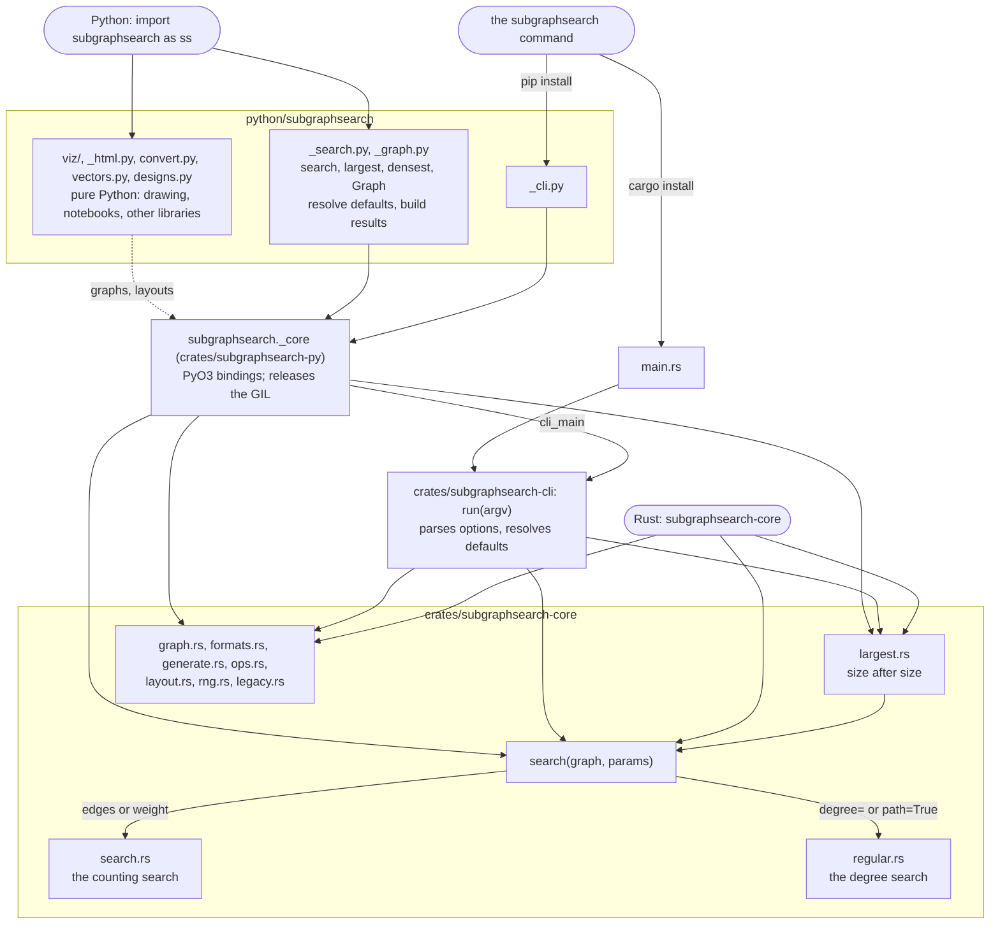

# Architecture

*Part of the [subgraphsearch documentation](README.md#documentation).*

subgraphsearch is a Rust library with two front ends: a command-line program, and a Python package
that wraps the library through a compiled extension. All searching, graph construction and file
handling happen in Rust; Python adds a friendlier API, plotting, notebook display and conversions to
other libraries. This page describes how the pieces fit together, for anyone changing the code.
[DEVELOPMENT.md](DEVELOPMENT.md) covers building, testing and releasing.

## The crates

The Cargo workspace in `crates/` has three members that share one version number.

- **`subgraphsearch-core`** is everything that computes, with only `rayon`, `serde` and `thiserror`
  as dependencies. It is published to crates.io for use from Rust.
  - `search.rs`: the counting search, for edge counts and weights; `regular.rs`: the degree
    search, for regular subgraphs, cycles and paths (see
    [ALGORITHM.md](ALGORITHM.md#two-searches));
    `largest.rs`: the search for the largest size of a shape.
  - `graph.rs`: `Graph` (a bit matrix and adjacency lists) and `WeightedGraph` (a byte matrix).
    Searches are generic over the `SearchGraph` trait, which both implement.
  - `generate.rs`, `ops.rs`, `layout.rs`: random graphs, operations and products, and the
    force-directed layout behind the drawings.
  - `formats.rs`: every file format. `rng.rs`: xoshiro256++ and the original programs' RANDU
    variant. `legacy.rs`: byte-for-byte emulation of the original C programs.
- **`subgraphsearch`** (`crates/subgraphsearch-cli`) is the command-line program. Its `lib.rs`
  holds the whole program behind `run(argv) -> exit code`, and `main.rs` only calls it, so the
  Python package can embed the same program.
- **`subgraphsearch-py`** builds the extension module `subgraphsearch._core`, with PyO3 for the
  bindings and maturin for the packaging (see the next section).

## PyO3 and maturin

The extension involves two tools with separate jobs: PyO3 decides what Python can call, and
maturin turns the result into something pip can install.

**[PyO3](https://pyo3.rs) is a Rust library: the bindings are Rust code** in
`crates/subgraphsearch-py/src/lib.rs`, written with its attributes.
- `#[pyclass(frozen)]` makes `Graph` and `WeightedGraph` Python types holding an `Arc` of the Rust
  graph. Frozen means immutable, so they need no locking and can be shared across threads.
- `#[pyfunction]`, with `#[pyo3(signature = ...)]` for keyword arguments and defaults, exposes each
  function. PyO3 converts the arguments (integers, strings, lists, bytes) and the results (tuples
  and lists) on its own, and the `err` helper maps the core's errors to `IOError` and `ValueError`.
- `#[pymodule] mod _core` lists what the module exports.
- `py.detach(...)` releases the GIL around every long Rust call.
- Two Cargo features of PyO3 shape the build: `abi3-py310` compiles against Python's stable ABI, so
  one compiled module serves every Python from 3.10 on, and `extension-module` leaves Python's own
  library unlinked, since the interpreter that imports the module provides it. Plain `cargo` cannot
  link such a module, which is why the crate is not a default workspace member.

**[maturin](https://www.maturin.rs) is the build tool: the packaging is configuration**, in
`pyproject.toml` and the release workflow.
- It is the package's build backend (`[build-system]`), so `uv sync`, `pip install` from source and
  the release workflow all build through it, calling `cargo` with the right linker flags.
- `[tool.maturin]` points it at the crate (`manifest-path`) and at the pure-Python package
  (`python-source = "python"`), and names the compiled module `subgraphsearch._core`. maturin puts
  the compiled module inside `python/subgraphsearch`, so a wheel holds a single package with both.
- The package takes its version from the crate (`dynamic = ["version"]`), so
  `scripts/bump_version.py` changes only the Cargo manifests.
- In `.github/workflows/release.yml`, `PyO3/maturin-action` builds a wheel per platform: manylinux
  and musllinux for Linux on x86-64 and ARM, macOS on Intel and Apple silicon, and Windows on x64
  and ARM, each built on a machine of its own architecture and smoke-tested there (the macOS Intel
  wheel under Rosetta, the musl wheels in an Alpine container), plus a source distribution that
  needs a Rust toolchain to install.

To change what Python can call, edit `lib.rs`; to change how the package is built or shipped, edit
`pyproject.toml` or the release workflow.

## The Python package

`python/subgraphsearch` is the package users import; maturin places the extension inside it as
`_core`.

- **Thin wrappers.** `_graph.py` and `_search.py` define `Graph`, `WeightedGraph`, `search`,
  `largest`, `densest`, `sparsest` and the result classes. A Python `Graph` holds a `_core.Graph`,
  which shares an immutable Rust graph through an `Arc`, so copies and searches never duplicate it.
  Large inputs, such as NumPy edge arrays and the vectors behind `Graph.from_vectors`, cross into
  Rust as byte buffers rather than Python lists.
- **Pure-Python additions.** `viz/` draws graphs, search diagnostics, spectra and matrices with
  Matplotlib and writes interactive HTML pages; `_html.py` gives graphs and results their notebook
  display; `convert.py` converts to and from networkx, igraph and SciPy; `vectors.py` and
  `designs.py` are helpers for codes, Hadamard matrices and block designs. These import their
  optional dependencies only when used.
- **Two commands.** The `subgraphsearch` command installed with the package (`_cli.py`) calls
  `_core.cli_main`, which is the Rust program's `run`, so the Python and Rust installs offer the
  identical program. `python -m subgraphsearch` (`__main__.py`) adds the Python-only commands:
  `explore`, `report` and `quickstart`.

## A search, end to end

`ss.search(g, 30, 346)` in Python:

1. `_search.search` checks the arguments and resolves the defaults that depend on the search, such
   as the kick size and the automatic tabu tenure, then calls `_core.search` with every setting
   given explicitly.
2. The binding builds a `SearchParams` and runs `subgraphsearch_core::search` inside
   `py.detach`, releasing the GIL, so other Python threads keep running meanwhile.
3. The core runs the experiments in parallel on rayon's thread pool, each with its own random
   stream derived from the seed, so results depend only on the seed and the settings.
4. Each experiment returns as a plain tuple, and Python builds the `Experiment` and
   `SearchResult` objects from them, recording the settings actually used.

The command line follows the same path from step 2, resolving the same defaults in
`crates/subgraphsearch-cli/src/lib.rs`. `subgraphsearch search --json` writes the core's serde
form of a result, and `SearchResult.load` reads it as well as Python's own saved results, so
`python -m subgraphsearch explore` can show a search run from the command line.

## Conventions

- **Defaults live in the front ends.** The core takes every setting explicitly
  (`SearchParams::new` gives Rust users sensible ones). Python and the CLI each resolve defaults that
  depend on the kind of search, such as no kicks for path searches and tenure 1 with the legacy
  generator, and must agree.
- **Saved results stay loadable.** A new `SearchParams` field needs a serde default equal to the
  old behavior, and the Python `SearchParams` dataclass a matching default, so older results load
  as they ran.
- **The legacy generator reproduces the C programs exactly.** Changes to the search must keep
  `rng="legacy"` byte-identical; the golden tests in `crates/subgraphsearch-cli/tests/golden.rs`
  check it against recorded output ([PORTING.md](PORTING.md)).
- **Speed-ups must not change results.** The same seed gives the same experiments, so an
  optimization must make exactly the same moves. The move scan in `search.rs` has three layers
  that skip work without changing it: bounds that rule out whole rows, buckets of columns by
  degree that narrow a row to the columns that can matter, and a pause that stops building
  buckets when they do not help. `skipping_rows_changes_no_result` compares every kind of search
  against a plain scan of every swap; keep it passing, and extend it for any new shortcut.

## Adding a search setting

A new setting touches every layer, in this order:

1. The core: a `SearchParams` field with a serde default, used by the search, and unit tests.
2. The binding: a keyword argument of `search` and `largest` in `crates/subgraphsearch-py/src/lib.rs`.
3. Python: the argument in `_search.py`, its default resolution, the `SearchParams` dataclass field
   and the docstring.
4. The CLI: an option in `crates/subgraphsearch-cli/src/lib.rs`, resolved the same way.
5. Tests in `python/tests`, including one through the command line, and the documentation:
   [ALGORITHM.md](ALGORITHM.md), [TUNING.md](TUNING.md) and the README's option table.
